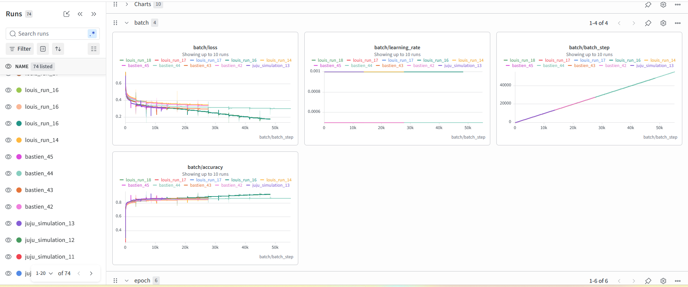

# Classification d'images histologiques du sein (IDC / non-IDC) avec TensorFlow

Projet du cours « IA et Deep Learning » — 2026-2027
Groupe : Louis VINCENT, Bastien FREDENUCCI, Justine CURIE (voir `CONTRIBUTORS`)

---

## 1. Sujet, problématique et objectifs

**Domaine :** images.
**Tâche :** classification binaire de fragments (*patchs*) d'images histologiques du sein.

Le carcinome canalaire infiltrant (*Invasive Ductal Carcinoma*, IDC) est le sous-type de cancer du sein le plus fréquent. Pour évaluer l'agressivité d'une tumeur, le pathologiste commence par repérer les zones atteintes d'IDC sur une lame entière, ce qui est long et fastidieux. Automatiser la détection des zones IDC permettrait d'aider à cette étape.

**Problématique :** un réseau de neurones convolutif (CNN) peut-il apprendre à distinguer les fragments IDC des fragments non-IDC à partir de leurs seules caractéristiques visuelles ?

**Objectifs :**
1. Construire un pipeline complet avec TensorFlow/Keras : préparation des données, modèle, entraînement, évaluation, démonstration.
2. Comparer plusieurs configurations d'hyperparamètres, avec un suivi des expériences dans Weights & Biases (W&B).
3. Évaluer le modèle avec des métriques adaptées à des classes déséquilibrées (rappel, précision, F1, balanced accuracy), en portant une attention particulière aux faux négatifs IDC.

**Portée :** la prédiction porte sur un fragment de 50 × 50 pixels, et non sur un diagnostic global à l'échelle d'un patient. Ce projet est un exercice académique et non un outil médical.

---

## 2. Données

### 2.1. Source

| Élément | Valeur |
| --- | --- |
| Nom | Breast Histopathology Images |
| Source | Kaggle : https://www.kaggle.com/datasets/paultimothymooney/breast-histopathology-images |
| Origine | Janowczyk A., Madabhushi A. (2016), *Deep learning for digital pathology image analysis: A comprehensive tutorial with selected use cases*, Journal of Pathology Informatics, 7:29 |
| Contenu | Patchs RGB de 50 × 50 pixels extraits de lames entières colorées à l'hématoxyline-éosine (H&E) |
| Taille d'origine | 277 524 patchs : 198 738 non-IDC et 78 786 IDC |
| Taille après nettoyage | 275 222 patchs (2 302 retirés, voir 3.2) |

Les classes sont **déséquilibrées** : environ 72 % de non-IDC. Un modèle qui prédirait toujours « non-IDC » obtiendrait donc déjà environ 72 % d'accuracy. C'est pourquoi l'accuracy seule ne suffit pas pour juger le modèle (voir section 5).

### 2.2. Obtenir les données

Les images ne sont pas incluses dans le rendu (plusieurs Go).

1. Télécharger l'archive depuis la page Kaggle : https://www.kaggle.com/datasets/paultimothymooney/breast-histopathology-images
2. Regrouper les images par classe avec `scripts/regrouper_images.ps1` (voir 3.1).
3. Nettoyer avec les scripts décrits en 3.2.
4. Renommer les dossiers `0` en `non-IDC` et `1` en `IDC`, et les placer à côté du notebook :

```text
breast_cancer_ML/
├── project.ipynb
└── breast-cancer/
    ├── IDC/
    └── non-IDC/
```

### 2.3. Format des noms de fichiers

Chaque fichier suit le format `<patient>_idx5_x<X>_y<Y>_class<C>.png`, par exemple `10253_idx5_x1351_y1101_class0.png` : `10253` identifie le patient, `X` et `Y` sont les coordonnées du patch dans la lame, et `C` la classe (0 = non-IDC, 1 = IDC). L'identifiant patient permet un découpage des données par patient (voir 3.3).

---

## 3. Prétraitement

### 3.1. Regroupement par classe

Dans l'archive d'origine, les images sont rangées par patient, puis par classe (`<patient>/0/` et `<patient>/1/`). Le script `regrouper_images.ps1` copie toutes les images dans deux dossiers communs, un par classe, pour permettre le chargement par Keras. En cas de nom de fichier déjà présent, un suffixe (`__1`, `__2`…) est ajouté afin de ne rien écraser.

### 3.2. Nettoyage

| Étape | Script | Traitement |
| --- | --- | --- |
| Doublons | `supprimer_doublons_images.ps1` | Compare taille et empreinte SHA-256 dans chaque classe ; garde un seul exemplaire des fichiers identiques |
| Contrôle des dimensions | `compter_dimensions_images.ps1` | Vérifie que les images font 50 × 50 pixels, repère les fichiers illisibles, exporte un rapport CSV |
| Retrait des non-conformes | `supprimer_images_non_conformes.ps1` | Supprime les images qui ne font pas 50 × 50 pixels |

Les scripts de suppression fonctionnent en simulation par défaut ; l'option `-Supprimer` applique réellement les changements.

### 3.3. Découpage des données

- **Version actuelle :** découpage aléatoire **par image**, 80 % entraînement / 20 % validation (`image_dataset_from_directory`, graine 42).
- **Limite :** les patchs d'un même patient sont très semblables. Avec un découpage par image, un même patient se retrouve dans l'entraînement et la validation, ce qui rend le score de validation optimiste (fuite de données).
- **Version visée :** découpage **par patient** (~70 % / 15 % / 15 %), avec un jeu de test utilisé une seule fois pour le score final.

### 3.4. Normalisation

Les pixels sont ramenés de [0, 255] à [0, 1] par une couche `Rescaling(1/255)` placée **dans le modèle** (voir 5.2).

---

## 4. Modèle

### 4.1. Architecture

| Couche | Détail |
| --- | --- |
| `Rescaling` | Normalisation des pixels dans [0, 1] |
| `Conv2D` + `MaxPooling2D` | 64 filtres 3 × 3, activation Leaky ReLU |
| `Conv2D` + `MaxPooling2D` | 64 filtres 3 × 3, activation Leaky ReLU |
| `Conv2D` + `MaxPooling2D` | 128 filtres 3 × 3, activation Leaky ReLU |
| `Flatten` | Passage en vecteur |
| `Dense` | 128 neurones, ReLU |
| `Dropout` | Taux `dropout_1` |
| `Dense` | 2 sorties (logits, sans softmax) |

### 4.2. Entraînement

| Paramètre | Valeur |
| --- | --- |
| Optimiseur | Adam, taux d'apprentissage 0,001 |
| Perte | `SparseCategoricalCrossentropy(from_logits=True)` |
| Taille de lot | 64 |
| Métrique suivie | Accuracy |
| Suivi | W&B, projet `breast-cancer-ML` |

Tous ces hyperparamètres sont centralisés dans le dictionnaire `PARAMETERS` du notebook (section 5.2) et enregistrés automatiquement dans W&B à chaque exécution.

---

## 5. Choix techniques et justifications

### 5.1. Données et prétraitement

- **Supprimer plutôt que redimensionner les images non conformes.** Les patchs en bord de lame sont plus petits que 50 × 50. Les agrandir déformerait la texture du tissu, qui est précisément l'information utilisée par le modèle. Ces images sont peu nombreuses : les retirer ne réduit pas le jeu de données de façon significative.
- **Supprimer les doublons exacts.** Un même fichier présent deux fois pourrait se retrouver à la fois en entraînement et en validation, et le modèle serait alors évalué sur une image déjà vue.
- **Pas d'augmentation de données dans la version actuelle.** Avec plus de 220 000 images d'entraînement, le volume est déjà important. L'augmentation reste une piste d'amélioration (section 8.2).

### 5.2. Modèle

- **Un CNN.** C'est l'architecture vue en cours pour les images. Les convolutions détectent des motifs locaux (contours, textures, forme et densité des noyaux cellulaires) quel que soit leur emplacement dans l'image, ce qui correspond à la façon dont un pathologiste repère l'IDC. Les images étant petites (50 × 50), un CNN de taille modeste suffit et s'entraîne rapidement, sans recourir au transfert d'apprentissage.
- **Trois blocs convolution + pooling, de 64 à 128 filtres.** Chaque `MaxPooling2D` divise la taille spatiale par deux (50 → 24 → 11 → 4 environ) : les premières couches captent des motifs simples, les dernières des motifs plus complexes sur une zone plus large. Augmenter le nombre de filtres en profondeur compense la réduction de taille.
- **Leaky ReLU dans les convolutions.** Contrairement à ReLU, elle laisse passer un petit gradient pour les valeurs négatives, ce qui évite que des neurones « meurent » (restent bloqués à zéro) pendant l'entraînement.
- **Normalisation dans le modèle (`Rescaling`).** La même transformation s'applique automatiquement à l'entraînement, à l'évaluation et lors de la démo, sans risque d'oublier de normaliser une nouvelle image.
- **Dropout** après la couche dense, pour limiter le surapprentissage. Son taux est réglable dans `PARAMETERS`.
- **Sortie en logits avec `from_logits=True`.** La dernière couche ne contient pas de softmax : la fonction de perte l'applique elle-même, de façon numériquement plus stable.
- **`SparseCategoricalCrossentropy`.** Les étiquettes fournies par `image_dataset_from_directory` sont des entiers (0 ou 1) : la version *sparse* les accepte directement, sans encodage one-hot.

### 5.3. Entraînement et suivi

- **Adam avec un taux d'apprentissage de 0,001.** C'est l'optimiseur de référence vu en cours, qui adapte le pas d'apprentissage à chaque poids ; 0,001 est sa valeur standard, un bon point de départ.
- **Lots de 64 images**, un compromis entre la stabilité du gradient et l'utilisation de la mémoire.
- **Weights & Biases** pour enregistrer les hyperparamètres et les courbes de chaque run, et comparer facilement les essais des trois membres du groupe.

### 5.4. Évaluation

- **Métriques au-delà de l'accuracy** : précision, rappel, F1, balanced accuracy, matrice de confusion. Avec environ 72 % de non-IDC, l'accuracy seule masquerait un modèle qui ignore la classe IDC.
- **Attention particulière au rappel IDC.** Dans un contexte médical, un fragment IDC classé sain (faux négatif) est plus grave qu'une fausse alerte.
- **Référence majoritaire** : l'accuracy obtenue en prédisant toujours la classe la plus fréquente, pour vérifier que le modèle fait mieux qu'une règle triviale.
- **Classe IDC repérée par son nom** (`class_names.index("IDC")`) et non supposée égale à 1 : Keras numérote les classes par ordre alphabétique des dossiers, ce qui donne `IDC = 0` et `non-IDC = 1`, l'inverse des étiquettes d'origine.

---

## 6. Expérimentations

Chaque membre du groupe a lancé ses propres entraînements, suivis dans W&B, en faisant varier les hyperparamètres. Au total, **74 runs** ont été enregistrés dans le projet W&B `breast-cancer-ML`.



*Capture du projet W&B : liste des runs (à gauche) et courbes par lot de 10 runs (perte, taux d'apprentissage, nombre de pas, accuracy).*

Ce que montrent ces courbes :
- **Perte** : elle chute rapidement au début de l'entraînement, puis diminue plus lentement, entre environ 0,2 et 0,35 selon les runs.
- **Accuracy** : elle dépasse 0,8 dès les premiers pas, puis progresse lentement vers environ 0,85-0,9.
- **Taux d'apprentissage** : la plupart des runs utilisent 0,001, d'autres une valeur plus faible.
- **Durée** : le nombre de pas d'entraînement varie d'un run à l'autre (jusqu'à environ 55 000), selon le nombre d'époques choisi.

 Le script d'entraînement utilisé pour ces runs est `louis_run_wandb.py`, et `models_louis.ipynb` contient une exécution antérieure. La configuration finale est celle du run ayant obtenu les meilleurs résultats sur la validation (`louis_run_17`) ; c'est celle que reproduit `project.ipynb`.

---

## 7. Installation et utilisation du notebook

### 7.1. Installation

**Prérequis :** Python 3.11.

```bash
python -m venv .venv
# Windows (PowerShell)
.venv\Scripts\Activate.ps1
# Linux / macOS
source .venv/bin/activate

pip install -r requirements.txt
```

Si PowerShell refuse l'activation, utiliser directement `.venv\Scripts\python.exe -m pip install -r requirements.txt`.

### 7.2. Avant de lancer le notebook

1. **Données :** placer les images dans `breast-cancer/IDC/` et `breast-cancer/non-IDC/`, à côté de `project.ipynb` (voir 2.2). Le notebook les lit via le chemin `breast-cancer` (constante `DATA_DIR`).
2. **W&B :** se connecter avec `wandb login`, ou travailler sans compte en définissant la variable d'environnement `WANDB_MODE=offline` avant de lancer Jupyter.
3. **Jupyter :** ouvrir `project.ipynb` depuis le dossier `breast_cancer_ML/` (ou dans VS Code), avec le noyau Python du `.venv`.

### Structure du projet

```text
breast_cancer_ML/
├── README.md
├── CONTRIBUTORS
├── requirements.txt
├── project.ipynb          # pipeline complet (notebook principal)
├── louis_run_wandb.py     # script d'entraînement des runs W&B
├── models_louis.ipynb     # exécution antérieure (effectifs, classes)
├── scripts/               # préparation des données (PowerShell)
├── images/                # captures utilisées dans le README
└── breast-cancer/         # images, non incluses dans le rendu
```

### 7.3. Déroulé du notebook

Exécuter les cellules **dans l'ordre**, de haut en bas.

| Section | Rôle | Ce qu'elle produit |
| --- | --- | --- |
| 5.1 Imports | Charge TensorFlow, W&B, NumPy, Matplotlib, Seaborn | — |
| 5.2 Paramètres | Définit `PARAMETERS` et `DATA_DIR` | — |
| 5.3 Suivi W&B | Ouvre un run W&B avec les paramètres | Lien vers le run |
| 5.4 Chargement | Crée `train_ds` et `validation_ds` | Nombre d'images trouvées par ensemble |
| 5.5 Construction | Définit le CNN | — |
| 5.6 Compilation | Configure optimiseur, perte et métrique | — |
| 6 Entraînement | Lance `model.fit` (étape la plus longue) | Progression par époque, modèle sauvegardé (`models.keras`) |
| 7 Courbes | Trace perte et accuracy par époque | 2 graphiques, époque de perte de validation minimale |
| 8 Évaluation | Prédit sur toute la validation | Perte, accuracy, correspondance des classes |
| 9 Matrice de confusion | Effectifs et proportions par classe | 2 heatmaps, VP / FN / FP / VN |
| 10 Métriques | Précision, rappel, F1 par classe | Graphique en barres, balanced accuracy, F1 macro, référence majoritaire |
| 11 Interprétation | Grille de lecture des résultats | — |

### 7.4. Tester une autre configuration

Modifier les valeurs dans `PARAMETERS` (section 5.2), changer le `name` du run en 5.3, puis réexécuter le notebook depuis 5.2. Chaque exécution crée un nouveau run dans W&B, ce qui permet de comparer les configurations dans l'interface.

---

## 8. Limites et améliorations

### 8.1. Limites

- **Fragments isolés :** le modèle voit un patch de 50 × 50 pixels sans son contexte dans la lame.
- **Découpage :** tant que le découpage reste par image, les scores sont optimistes (voir 3.3).
- **Sélection sur la validation :** la configuration a été choisie sur la validation, qui ne peut donc pas servir d'évaluation finale ; seul un jeu de test indépendant le permet.
- **Déséquilibre des classes :** l'entraînement ne le compense pas (pas de pondération des classes).
- **Source unique :** toutes les lames viennent du même jeu de données ; les performances sur d'autres hôpitaux ou d'autres colorations ne sont pas garanties.
- **Reproductibilité :** la graine fixe le découpage, mais pas l'initialisation des poids ni l'ordre des lots.

### 8.2. Améliorations possibles

- Découpage par patient avec jeu de test indépendant.
- Pondération des classes (`class_weight`) ou ajustement du seuil de décision pour favoriser le rappel IDC.
- Augmentation de données (rotations, symétries : un tissu n'a pas d'orientation privilégiée).
- `EarlyStopping` avec restauration des meilleurs poids.
- Transfert d'apprentissage (ResNet, EfficientNet pré-entraînés).
- Courbe ROC et AUC.

---

## 9. Sources

- Jeu de données : Kaggle, *Breast Histopathology Images* (lien en section 2.1).
- Janowczyk A., Madabhushi A. (2016). *Deep learning for digital pathology image analysis: A comprehensive tutorial with selected use cases*. Journal of Pathology Informatics, 7:29.
- Documentation TensorFlow / Keras : `image_dataset_from_directory`, `Sequential`, couches `Conv2D`, `MaxPooling2D`, `Dropout`, `Rescaling`.
- Documentation Weights & Biases : intégration Keras (`WandbMetricsLogger`, `WandbModelCheckpoint`).
- Supports et TP du cours « IA et Deep Learning ».
- Assistants d'IA : Claude (Anthropic) pour l'aide à la structuration du rapport et la relecture des explications.

---

## 10. Contributions

Voir le fichier `CONTRIBUTORS`.